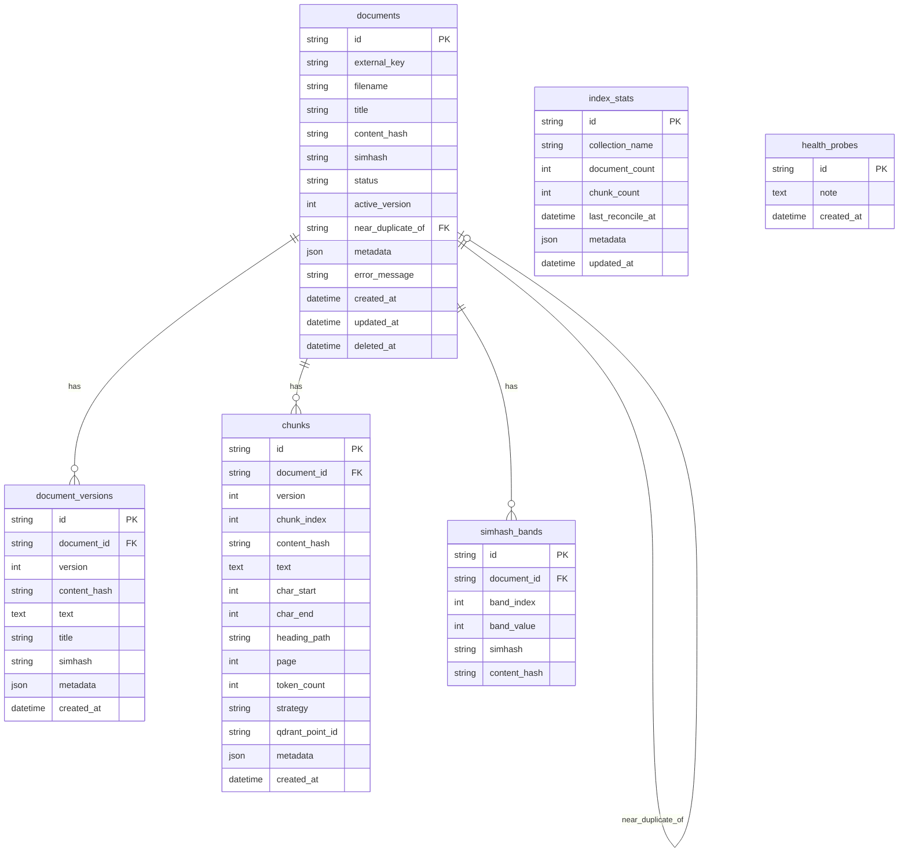

# Database design (Phase 2)

Postgres (Neon) is the source of truth for document identity, versions, chunks,
and SimHash LSH bands. Qdrant holds derived dense/sparse vectors filtered by
`doc_id` + `version`. Retrieval must ignore points whose `version` is not equal
to `documents.active_version`.

## Entity relationship

## Lifecycle statuses

`PENDING` → `INDEXING` → `ACTIVE`, plus `FAILED`, `DELETING`, `DELETED`.

- Soft delete sets `DELETED` and frees `external_key` (partial unique index
  excludes deleted rows).
- Exact duplicates share `content_hash` and are not indexed twice.
- Near duplicates (Hamming ≤ threshold via 4×16-bit bands) are indexed and
  flagged with `near_duplicate_of`.
